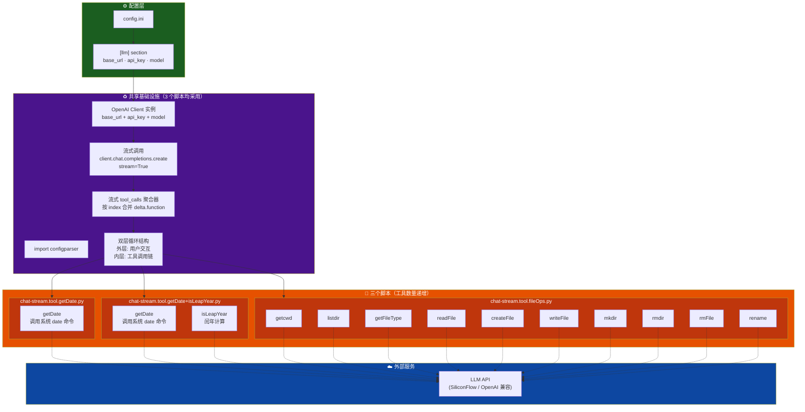
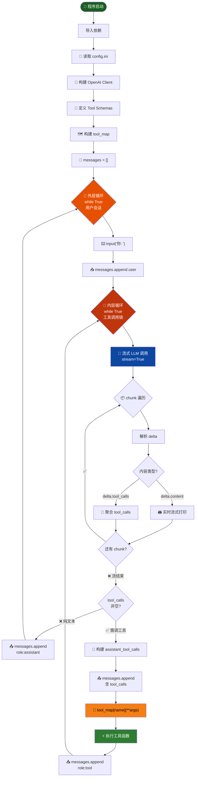

# Practice02 · LLM Function Calling 工具实践

基于 OpenAI Function Calling 的多工具对话系统实践项目，包含三个渐进式脚本：从单一工具到组合工具，再到十合一文件系统操作套件，实现"说人话就能操作文件系统"。

---

## 📁 项目文件结构

```
Practice02/
├── config.ini                              # LLM 连接配置（API 地址 / 密钥 / 模型）
├── chat-stream.tool.getDate.py             # 脚本 1：单工具 —— 获取系统日期时间
├── chat-stream.tool.getDate+isLeapYear.py  # 脚本 2：双工具 —— 日期 + 闰年判断
├── chat-stream.tool.fileOps.py             # 脚本 3：十工具 —— 文件/目录 CRUD 操作
├── project_arch.mmd                        # 项目整体代码架构图（Mermaid 纯文本）
├── fileOps_arch.mmd                        # 脚本 3 专项架构图（Mermaid 纯文本）
└── README.md                               # 本说明文档
```

---

## ⚙️ 配置说明 (`config.ini`)

```ini
[llm]
base_url = https://api.siliconflow.cn/v1
api_key = sk-xxxxxxxxxxxxxxxxxxxxxxxxxxxxxxxxxxxxxxxx
model = deepseek-ai/DeepSeek-V4-Pro
```

| 参数 | 说明 |
|------|------|
| `base_url` | LLM API 端点（OpenAI 兼容协议） |
| `api_key` | API 访问密钥 |
| `model` | 模型名称（支持任意 OpenAI 兼容模型） |

---

## 🚀 三个脚本对比

| 特性 | 脚本 1 | 脚本 2 | 脚本 3 |
|------|--------|--------|--------|
| **文件名** | `chat-stream.tool.getDate.py` | `chat-stream.tool.getDate+isLeapYear.py` | `chat-stream.tool.fileOps.py` |
| **工具数量** | 1 | 2 | 10 |
| **工具类型** | 系统信息 | 系统信息 + 数学计算 | 文件/目录 CRUD |
| **依赖库** | `openai`, `configparser`, `json`, `platform`, `subprocess` | 同脚本 1 | `openai`, `configparser`, `json`, `os`, `pathlib`, `shutil` |
| **适用场景** | 入门的 Function Calling 示例 | 多工具协同调度示例 | 完整的文件系统对话操作 |

---

## 🔧 工具全景一览表

### 脚本 1：`chat-stream.tool.getDate.py`（1 工具）

| # | 函数名 | 功能 | 实现方式 |
|---|--------|------|----------|
| 1 | `getDate` | 获取当前电脑日期时间 | Windows: PowerShell `date`；Unix: `date` 命令 |

### 脚本 2：`chat-stream.tool.getDate+isLeapYear.py`（2 工具）

| # | 函数名 | 功能 | 实现方式 |
|---|--------|------|----------|
| 1 | `getDate` | 获取当前电脑日期时间 | 同脚本 1 |
| 2 | `isLeapYear` | 判断年份是否闰年 | 数学公式：`year % 4 == 0 and (year % 100 != 0 or year % 400 == 0)` |

### 脚本 3：`chat-stream.tool.fileOps.py`（10 工具）

| # | 函数名 | 功能描述 | 必需参数 | 可选参数 |
|---|--------|----------|----------|----------|
| 1 | `getcwd` | 获取当前工作目录 | — | — |
| 2 | `listdir` | 列出目录内容，标注 `[file]` / `[dir]` | — | `path`（默认 `.`） |
| 3 | `getFileType` | 获取文件扩展名、大小（字节）、是否纯文本 | `filepath` | — |
| 4 | `readFile` | 读取纯文本文件完整内容（UTF-8） | `filepath` | — |
| 5 | `createFile` | 在指定目录下创建新文件（自动创建父目录） | `dirpath`, `filename` | `content`（默认空） |
| 6 | `writeFile` | 覆盖写入文件内容（自动创建父目录） | `filepath`, `content` | — |
| 7 | `mkdir` | 创建新目录（支持递归创建父目录） | `dirpath` | — |
| 8 | `rmdir` | 递归删除目录及其下所有内容 | `dirpath` | — |
| 9 | `rmFile` | 删除指定文件（不删目录） | `filepath` | — |
| 10 | `rename` | 重命名文件或目录（src → dst） | `src`, `dst` | — |

---

## 🏗️ 项目整体代码架构图

> 详见 **[`project_arch.mmd`](./project_arch.mmd)** —— 包含 5 张 Mermaid 架构图：
> 1. **项目整体组件架构** —— 外部服务 → 配置层 → 共享基础设施 → 三个脚本的工具全景
> 2. **通用执行流程（三层控制流）** —— 外层用户循环 → 内层工具链循环 → 流式 chunk 消费循环
> 3. **三脚本工具全景图** —— 13 个工具总览
> 4. **Tool Schema → tool_map 映射关系** —— LLM 决策 → Schema 匹配 → 客户端分发
> 5. **数据流与消息累积模型** —— 时序图展示 User → Script → LLM → Tool → FileSystem 全链路

### 核心架构总览



---

## 🔄 通用执行流程



---

## 🧠 核心设计模式

### 1. Tool Schema 定义
每个工具通过 OpenAI Function Calling 标准 JSON Schema 向 LLM 声明其功能、参数类型和约束：

```python
tools = [
    {
        'type': 'function',
        'function': {
            'name': 'readFile',
            'description': '获取指定文件的内容（仅支持纯文本格式文件）',
            'parameters': {
                'type': 'object',
                'properties': {
                    'filepath': {'type': 'string', 'description': '文件路径'},
                },
                'required': ['filepath'],
            },
        },
    },
    # ... 更多工具
]
```

### 2. tool_map 分发机制
Schema 定义与 Python 函数实现通过字典映射解耦：

```python
tool_map = {
    'getcwd': getcwd,
    'listdir': listdir,
    'getFileType': getFileType,
    'readFile': readFile,
    # ... 其他函数
}

# 运行时调用
output = tool_map[name](**json.loads(arguments))
```

### 3. 流式 tool_calls 聚合
LLM 的流式响应中，`tool_calls` 可能分多个 chunk 到达，需要按 `index` 聚合 `id`、`name`、`arguments` 字段：

```python
tool_calls = {}
for chunk in stream:
    delta = chunk.choices[0].delta
    if delta.tool_calls:
        for tc in delta.tool_calls:
            item = tool_calls.setdefault(tc.index, {'id': '', 'name': '', 'arguments': ''})
            if tc.id:          item['id'] = tc.id
            if tc.function:
                if tc.function.name:      item['name'] += tc.function.name
                if tc.function.arguments: item['arguments'] += tc.function.arguments
```

### 4. 双层循环消息管理
- **外层循环**：每次用户输入开始新一轮对话
- **内层循环**：工具调用 → LLM 再决策 → 可能再调用工具，直至 LLM 返回纯文本
- **消息累积**：`messages` 列表持续追加 `user` / `assistant` / `tool` 角色消息，保持上下文连续

---

## 🎯 使用示例

### 运行脚本 3（文件操作）

```bash
python chat-stream.tool.fileOps.py
```

**交互示例：**

```
你: 当前目录下有什么文件？
AI: 让我帮你查看当前目录的内容。
[tool] listdir -> [file] chat-stream.tool.fileOps.py
[file] config.ini
[file] README.md
AI: 当前目录下有以下文件和目录：
- chat-stream.tool.fileOps.py
- config.ini
- README.md

你: 创建一个名为 test.txt 的文件，内容是 Hello World
AI: 好的，我来创建这个文件。
[tool] createFile -> 已创建 .\test.txt
AI: 已成功创建 test.txt 文件，内容为 "Hello World"。

你: 读取 test.txt 的内容
AI:
[tool] readFile -> Hello World
AI: test.txt 的内容是：Hello World
```

### 运行脚本 2（日期 + 闰年）

```bash
python chat-stream.tool.getDate+isLeapYear.py
```

**交互示例：**

```
你: 今天是几号？2024 年是闰年吗？
AI: 让我帮你查看。
[tool] getDate -> 2025年7月14日 星期一 ...
[tool] isLeapYear -> True
AI: 今天是 2025年7月14日。2024 年是闰年（True）。
```

---

## 📊 技术栈

| 组件 | 技术选型 |
|------|----------|
| **LLM SDK** | `openai` Python SDK（兼容 OpenAI API 协议） |
| **配置管理** | `configparser` 读取 INI 文件 |
| **文件操作** | `os` + `pathlib` + `shutil` 标准库 |
| **系统命令** | `subprocess` + `platform` 跨平台适配 |
| **流式解析** | SSE（Server-Sent Events）流式 chunk 解析 |
| **参数序列化** | `json.loads` 解析 JSON arguments |

---

## 📐 架构图文件说明

| 文件 | 内容 |
|------|------|
| **`project_arch.mmd`** | 项目整体架构：5 张图涵盖组件架构、执行流程、工具全景、Schema 映射、数据流时序图 |
| **`fileOps_arch.mmd`** | 脚本 3 专项架构：10 文件操作工具的详细流程图 |

可直接将 `.mmd` 文件内容粘贴至 [Mermaid Live Editor](https://mermaid.live/) 进行可视化渲染。

---

## 📝 学习要点

1. **Function Calling 基本原理**：LLM 通过 Schema 理解工具能力，返回结构化调用指令而非直接执行
2. **流式处理**：`stream=True` + 累积 `delta.tool_calls`，实现实时打印 + 完整工具调用解析
3. **消息角色协议**：`user` → `assistant` (含 tool_calls) → `tool` → 循环 → `assistant` (纯文本)
4. **错误处理**：工具函数内置路径校验和异常捕获，返回可读的错误信息供 LLM 理解并反馈用户
5. **跨平台**：`getDate` 通过 `platform.system()` 判断 Windows/Unix，选择合适的系统命令
6. **纯文本检测**：`getFileType` 通过扩展名白名单 + 二进制 `\x00` 检测双重判断